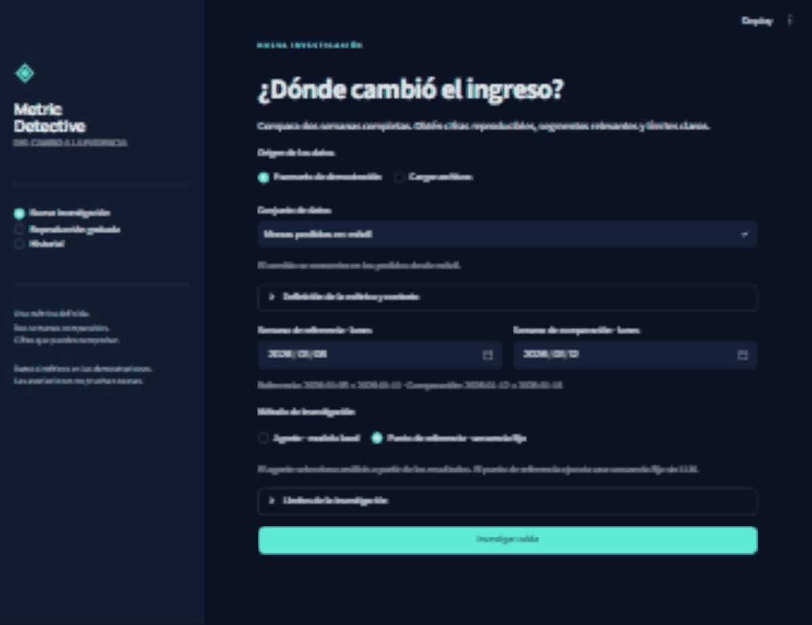

# Metric Detective

**Investiga un cambio en ingresos. Revisa la evidencia. Reconoce lo que falta.**

Aplicación local de portafolio con interfaz en español, un investigador acotado
con LangGraph, cálculos exactos en DuckDB y trabajos persistentes en PostgreSQL.
Compara dos semanas completas: cambio en ingresos, contribuciones de volumen y
ticket, segmentos, evolución diaria y evidencia reproducible. Solo datos sintéticos.

[English README](README.md) · [Contrato](docs/contract.md) ·
[Arquitectura](docs/architecture.md) · [Verificaciones](docs/verification.md) ·
[Evaluación](docs/evaluation.md)



El recorrido muestra una ejecución real del punto de referencia. La reproducción
grabada, el análisis fijo y una investigación nueva con modelo son modos distintos.

## Qué puedes hacer

1. Seleccionar un escenario o cargar CSV compatibles de pedidos/cargas.
2. Elegir dos semanas completas, una zona horaria y una moneda.
3. Iniciar una investigación asíncrona, seguirla o volver después.
4. Revisar hallazgos, hipótesis, datos faltantes, gráficos y evidencias.
5. Exportar el informe a JSON o HTML autónomo.

Cargas incompletas o pedidos duplicados bloquean el diagnóstico de negocio.
Sin declaraciones de carga, la completitud queda sin verificar: la presencia de
pedidos no la demuestra. Las afirmaciones cuantitativas usan rutas de evidencia
y plantillas de observaciones validadas. Las asociaciones no prueban causas.

## Inicio con Docker Compose

Requiere Docker con Compose v2. El punto de referencia y la reproducción no
necesitan modelo ni clave. Una investigación nueva con el agente necesita un
servidor Ollama accesible y el modelo configurado.

```sh
cp .env.example .env
docker compose up --build -d
```

En PowerShell usa `Copy-Item .env.example .env` en el primer paso. Abre la
[interfaz](http://localhost:8501) y la [API](http://localhost:8000/docs). Elige
**Punto de referencia · secuencia fija** para investigar sin modelo, o
**Reproducción grabada** para explorar el informe guardado.

Compose ejecuta API, trabajador, interfaz y PostgreSQL con volúmenes persistentes
y puertos en loopback. Configura `.env`: la contraseña incluida es un ejemplo
local. `docker compose logs -f worker` muestra el trabajo;
`docker compose stop` detiene servicios y conserva los datos. El
[registro de verificación](docs/verification.md) distingue lo ejecutado de la
configuración que no se ha probado.

## Inicio nativo

Requiere Python 3.11–3.13, `uv` y PostgreSQL con una base/usuario que coincidan con
`MD_DATABASE_URL`. Consulta las versiones probadas en el registro de verificación.
No se sustituye la persistencia por SQLite.

```sh
cp .env.example .env
uv sync --locked --extra dev
uv run --env-file .env metric-detective init-db
```

Desde la raíz del repositorio, ejecuta cada comando en una terminal:

```sh
uv run --env-file .env uvicorn metric_detective.api:create_app --factory --host 127.0.0.1 --port 8000
```

```sh
uv run --env-file .env metric-detective worker
```

```sh
uv run --env-file .env streamlit run src/metric_detective/ui.py --server.port 8501
```

La API prepara los escenarios. Regenera los datos incluidos con
`uv run metric-detective generate --output data --seed 17`.

## Modelo real

El proveedor implementado es **Ollama con `ChatOllama` de LangChain** y selección
estructurada. No se promete compatibilidad con otros proveedores.

```sh
ollama pull qwen3.5:4b
ollama serve
```

Si Ollama ya está activo, usa esa instancia. Configuración:

```dotenv
MD_LLM_PROVIDER=ollama
MD_LLM_MODEL=qwen3.5:4b
MD_OLLAMA_BASE_URL=http://localhost:11434
MD_LLM_API_KEY=
```

Compose usa `http://host.docker.internal:11434`; puedes sustituirlo con
`MD_COMPOSE_OLLAMA_BASE_URL`. El endpoint debe ser accesible desde el trabajador.
En ejecución nativa basta loopback. La clave bearer es opcional para un endpoint
Ollama protegido; una instancia local normal no la necesita.

El modelo elige herramientas/parámetros a partir de agregados. Python ejecuta
consultas controladas. No se ejecuta SQL/Python del modelo ni se le envían tablas
originales o identificadores de pedidos. Hay límites de llamadas, profundidad,
tiempo, tokens y reintentos. Los errores producen límites explícitos sin cambiar
silenciosamente al modelo por un doble de pruebas.

El presupuesto predeterminado es de 20 000 tokens por investigación. Un límite
menor puede producir un informe parcial. La evaluación guardada conserva la
configuración real de cada ejecución aunque cambien los valores predeterminados.

## Datos y herramientas

Columnas predeterminadas de pedidos:
`order_id,paid_at,status,amount,currency,device,channel,country`.
Columnas de cargas: `date,source,status`. Se necesita una declaración por cada
fecha/fuente esperada. La configuración adapta columnas, estados, zona, moneda y
dimensiones. Consulta el [contrato](docs/contract.md), la
[solicitud completa](examples/request.json) y el [ejemplo HTTP](docs/api.md).

Herramientas: `check_data_quality`, `compare_periods`,
`decompose_revenue_change`, `rank_segment_changes`, `inspect_daily_pattern` y
`drill_down`. Cada evidencia conserva unidades, periodos, filtros, filas,
advertencias, consulta/fórmula y huella de datos. La descomposición simétrica
reparte por mitades la interacción, conserva fracciones exactas y cuadra los
importes mostrados. No se suman particiones distintas como dispositivo y canal.

Hay ocho escenarios de comercio electrónico: menos pedidos móviles; menor ticket
con volumen estable; cargas incompletas; duplicados de referencia; contribuciones
positivas y negativas; explicaciones ambiguas; ausencia de cambio relevante;
periodos/segmentos sin pedidos. El ejemplo de servicios usa facturas pagadas y el
mismo motor mediante configuración.

La semilla de desarrollo es 17 y las de evaluación son distintas. Las etiquetas
no llegan al agente. Solo se evalúan conclusiones inferibles de los datos
entregados, sin asumir que se puede identificar la causa oculta del generador.

## Pruebas y evaluación

```sh
uv sync --locked --extra dev
uv run --extra dev ruff check .
uv run --extra dev ruff format --check .
uv run --extra dev pytest -q
```

CI usa dobles deterministas identificados sin credenciales de modelos. Las pruebas
de PostgreSQL/recuperación requieren `MD_TEST_DATABASE_URL` con una base separada y
desechable. La evaluación real del LLM está aparte. Consulta
[resultados y comandos](docs/evaluation.md) y
[comprobaciones ejecutadas](docs/verification.md).

Agente y punto de referencia usan los mismos datos/herramientas. Se miden
exactitud, cobertura de segmentos, afirmaciones sin respaldo, abstención,
llamadas, latencia y tokens. El costo no disponible se registra como tal. No se
afirma superioridad del agente sin evidencia.

## Decisiones, límites y licencia

Python · DuckDB · Pydantic · LangGraph · LangChain Ollama · FastAPI · PostgreSQL ·
Streamlit · Plotly · Docker Compose · pytest · Ruff · GitHub Actions.

Los trabajadores usan bloqueo, leases, fencing, estado persistido e IDs estables
de evidencia. El registro documenta la interrupción real y su recuperación. Es un
MVP local de portafolio: una moneda, semanas completas e importes pagados. Las
devoluciones quedan fuera de alcance. Lee la [arquitectura](docs/architecture.md)
y las [limitaciones](docs/limitations.md).

El [ejemplo opcional de n8n](examples/n8n.md) inicia un trabajo, consulta su estado
y prepara una notificación. No envía mensajes ni es necesario para el producto.

El código original tiene licencia [MIT](LICENSE).
