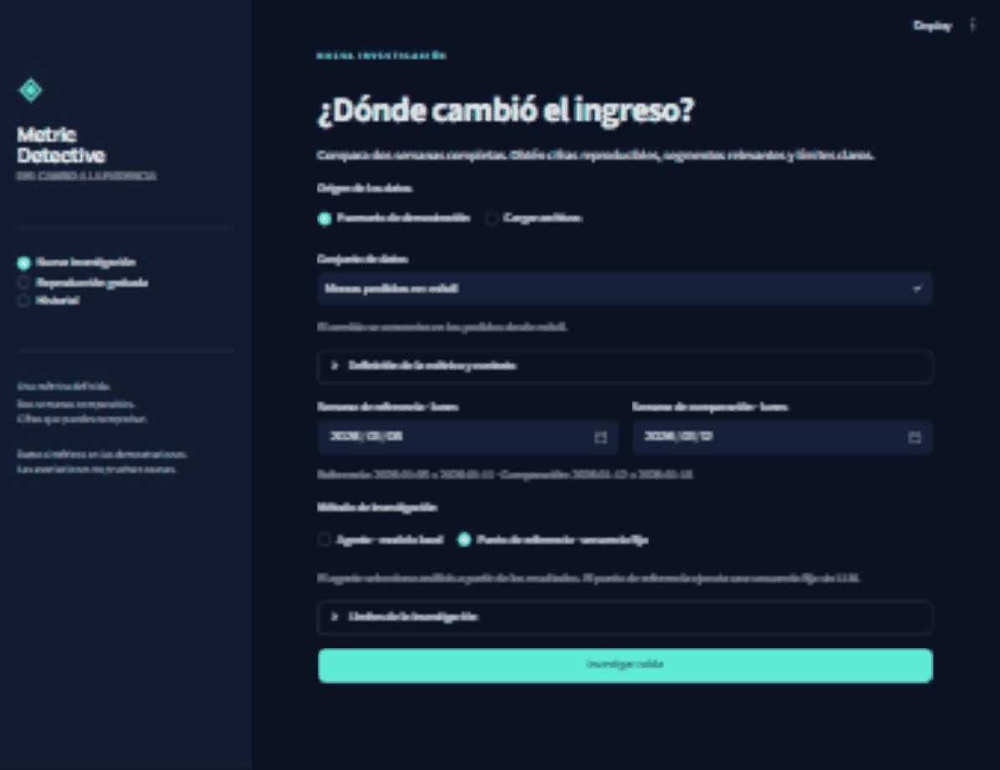

# Metric Detective

**Investigate a revenue change. Inspect the evidence. Know what remains unknown.**

A local portfolio application with a Spanish interface, a bounded LangGraph
investigator, exact DuckDB calculations and durable PostgreSQL jobs. Compare two
complete weeks: revenue changes, volume/ticket contributions, segment
concentration, daily charts and reproducible evidence. Synthetic data only.

[Leer en español](README.es.md) · [Data contract](docs/contract.md) ·
[Architecture](docs/architecture.md) · [Verification](docs/verification.md) ·
[Evaluation](docs/evaluation.md)



The walkthrough shows a real baseline run. Baseline, prerecorded replay and a
fresh model investigation are visibly separate modes.

## What you can do

1. Choose a demonstration or upload compatible order/load CSVs.
2. Select disjoint Monday–Sunday weeks, an explicit timezone and one currency.
3. Start an asynchronous investigation and follow its progress or return later.
4. Inspect findings, hypotheses, missing data, charts and evidence.
5. Export JSON or a self-contained HTML report.

Incomplete loads or duplicate orders block business diagnosis. Missing load
declarations leave completeness unverified; existing orders do not prove it.
Quantitative findings use checked evidence paths and constrained observation
templates. Associations are never presented as demonstrated causes.

## Docker Compose quick start

Requires Docker with Compose v2. Baseline and replay need no model or API key.
A new agent investigation additionally needs a reachable Ollama server/model.

```sh
cp .env.example .env
docker compose up --build -d
```

In PowerShell, use `Copy-Item .env.example .env` for the first command. Open
[the workspace](http://localhost:8501) and [API docs](http://localhost:8000/docs).
Choose **Punto de referencia · secuencia fija** for a new model-free investigation
or **Reproducción grabada** to inspect the saved model report.

Compose runs API, worker, UI and PostgreSQL with persistent database/dataset
volumes and loopback ports. Configure `.env`; the included password is a local
development example. `docker compose logs -f worker` follows work;
`docker compose stop` stops services while preserving data. The
[verification record](docs/verification.md) distinguishes executed checks from
configuration that has not been run.

## Native quick start

Requires Python 3.11–3.13, `uv` and PostgreSQL with a database/login matching
`MD_DATABASE_URL`. Tested versions appear in the verification record. PostgreSQL
is the real persistence backend; no SQLite substitute is used.

```sh
cp .env.example .env
uv sync --locked --extra dev
uv run --env-file .env metric-detective init-db
```

Run these in three terminals from the repository root:

```sh
uv run --env-file .env uvicorn metric_detective.api:create_app --factory --host 127.0.0.1 --port 8000
```

```sh
uv run --env-file .env metric-detective worker
```

```sh
uv run --env-file .env streamlit run src/metric_detective/ui.py --server.port 8501
```

The API initializes synthetic demonstrations. To regenerate the included data:
`uv run metric-detective generate --output data --seed 17`.

## Configure a live model

The implemented provider is **Ollama via LangChain `ChatOllama`**, with structured
tool selection. Other providers are not advertised as supported.

```sh
ollama pull qwen3.5:4b
ollama serve
```

Use the existing instance if Ollama is already running. Environment settings:

```dotenv
MD_LLM_PROVIDER=ollama
MD_LLM_MODEL=qwen3.5:4b
MD_OLLAMA_BASE_URL=http://localhost:11434
MD_LLM_API_KEY=
```

Compose defaults to `http://host.docker.internal:11434`;
`MD_COMPOSE_OLLAMA_BASE_URL` overrides it. The endpoint must be reachable from the
worker container. Native execution uses normal loopback. The optional bearer key
supports a protected Ollama endpoint; a normal local instance needs no key.

The LLM selects controlled tools/parameters from aggregates. Python executes
allowlisted queries with bound values. Model-written SQL/Python is not executed;
original tables and order IDs never enter model context. Budgets limit analytical
calls, depth, elapsed time, tokens and retries. Failures produce explicit partial
results, never a silent fallback to a test double.

The default token budget is 20,000 per investigation. A tighter budget can produce
a partial report; saved evaluations retain each run's actual configuration when
application defaults change.

## Data and tools

```csv
order_id,paid_at,status,amount,currency,device,channel,country
synthetic-001,2026-01-05T10:00:00-06:00,paid,125.50,MXN,mobile,organic,MX
```

`loads.csv` has `date,source,status`; each selected date/expected source needs an
explicit completeness declaration. Configuration maps columns, statuses,
timezone, currency and dimensions. See the [exact contract](docs/contract.md),
[complete request](examples/request.json) and [HTTP walkthrough](docs/api.md).

Tools: `check_data_quality`, `compare_periods`, `decompose_revenue_change`,
`rank_segment_changes`, `inspect_daily_pattern`, `drill_down`. Evidence preserves
units, periods, filters, record counts, warnings, SQL/formulas and fingerprints.
Symmetric decomposition splits volume/ticket interaction evenly, retains exact
fractions and reconciles displayed monetary contributions. Separate segment
partitions must not be added together.

| Demonstration | Observable situation |
| --- | --- |
| `mobile_drop` | Fewer mobile orders |
| `ticket_drop` | Lower ticket with stable order count |
| `incomplete_loads` | Explicitly incomplete loads |
| `duplicate_reference` | Duplicate reference identifiers |
| `mixed_segments` | Positive and negative contributions |
| `ambiguous` | Data compatible with several explanations |
| `no_change` | No relevant change under the configured threshold |
| `empty_period` | Periods or segments without orders |
| `services_ticket_drop` | Paid service invoices; same engine via configuration |

Development seed is 17; evaluation seeds are separate. Generator labels never
enter the investigator. Evaluation scores observable conclusions without assuming
the hidden generator mechanism is identifiable.

## Test and reproduce

```sh
uv sync --locked --extra dev
uv run --extra dev ruff check .
uv run --extra dev ruff format --check .
uv run --extra dev pytest -q
```

CI uses explicitly named deterministic provider doubles without model credentials.
PostgreSQL integration/interruption tests require `MD_TEST_DATABASE_URL` for a
separate expendable test database. Live evaluation is separate. Read the
[measured evaluation and commands](docs/evaluation.md) and
[actual verification record](docs/verification.md).

Baseline and agent use the same tools/data. Metrics cover numerical accuracy,
segment coverage, unsupported claims, correct abstention, calls, latency and
provider tokens. Unavailable cost remains unavailable. No claim that the model
beats the baseline is made without evidence.

## Design, scope and license

Python · DuckDB · Pydantic · LangGraph · LangChain Ollama · FastAPI · PostgreSQL ·
Streamlit · Plotly · Docker Compose · pytest · Ruff · GitHub Actions.

Workers use leases, row locking, fencing, persisted graph state and stable
evidence IDs. The verification record documents the real interruption experiment.
This is an early local portfolio MVP, not a multi-tenant causal inference
platform. One currency, complete weeks and paid-order amounts are supported;
returns are outside scope. See [architecture](docs/architecture.md) and
[limitations](docs/limitations.md).

The optional [n8n example](examples/n8n.md) starts a job, polls and prepares a
notification payload. It sends nothing and is not needed to run the product.

Original code is licensed under [MIT](LICENSE).
