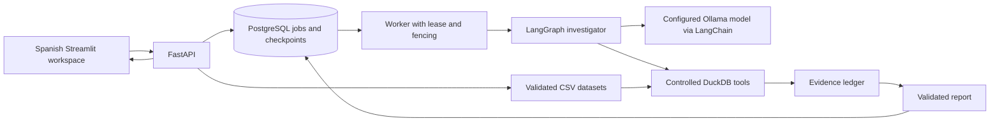
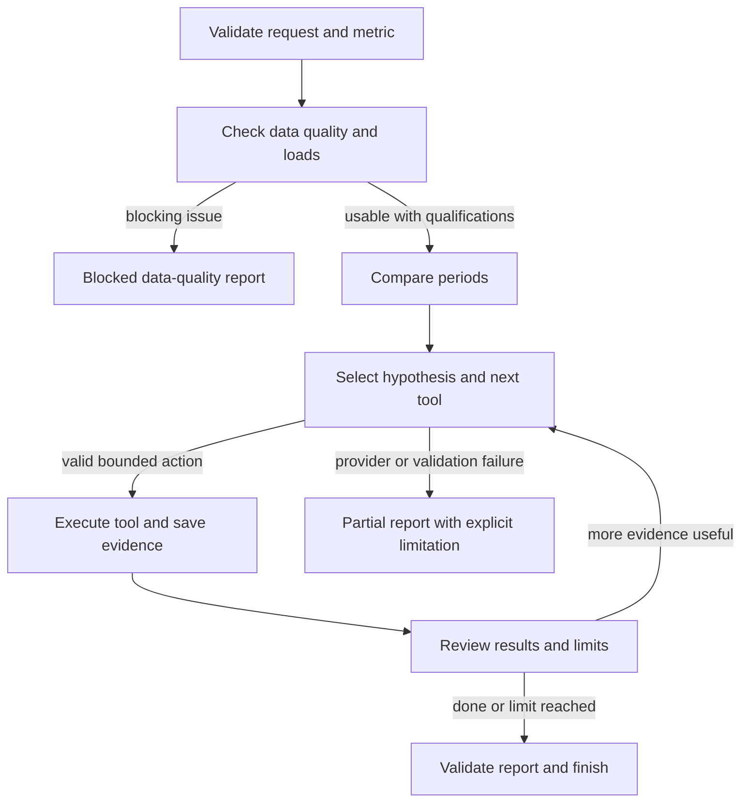

# Architecture and execution

Metric Detective is one bounded investigator, one analytical engine and one
asynchronous worker service. Its demonstrations use synthetic data.

## Request and deterministic gates

The API validates a metric definition, dataset ID and two complete local weeks,
then creates a queued job and returns its identifier. It does not run a long
investigation inside the HTTP request.

The graph validates the request and data quality before business diagnosis. It
checks source-load completeness, duplicates, data types and the metric contract.
An explicitly incomplete load or blocking quality problem stops the business
diagnosis. Missing completeness evidence is recorded as unverified.

After mandatory comparison, a decision node receives aggregated evidence and
selects a structured tool action and permitted parameters. Python validates that
action, executes a controlled tool and records its output. The next decision sees
the updated evidence. Decisions contain a short action summary and evidence
references; the application does not request or publish hidden model reasoning.

## Analytical tools

| Tool | Purpose |
| --- | --- |
| `check_data_quality` | Metric-contract and load-completeness evidence |
| `compare_periods` | Paid revenue, order count, average ticket and total change |
| `decompose_revenue_change` | Exact volume/ticket decomposition with explicit interaction |
| `rank_segment_changes` | Reconciled contributions within one allowed partition |
| `inspect_daily_pattern` | Zero-filled local-day evolution, optionally filtered |
| `drill_down` | At most two configured dimensions, with permitted filters |

The initial budget is eight analytical calls total, including mandatory quality
and comparison calls, two segmentation levels, a deadline, a token budget and
limited retries. Limits are enforced by code rather than prompt-only
instructions. The fixed baseline uses the same tools/data with a predefined
eight-call sequence. Deadline checks occur between bounded ingestion/analysis
nodes; those operations are not preemptively interrupted. Provider requests have
their own remaining-time timeout.

## Persistence, concurrency and recovery

PostgreSQL stores queued jobs, saved graph state, reports and evidence. Workers
claim work atomically with row locking and leases; fencing prevents an expired
worker from writing over a later owner. A session advisory lock also prevents
two live worker sessions from processing the same job, including after lease
expiry. Heartbeats maintain a live claim.
Checkpoint writes are atomic with stored state/evidence. Stable evidence IDs avoid
duplicate evidence when interrupted work is retried.

Recovery resumes from persisted progress. Before an external model request, a
checkpoint records `provider_inflight`. If the worker dies while that marker is
set, recovery completes the report as partial with unknown provider usage; it
does not repeat the request and risk spending the budget again. This cannot prove
whether the provider finished or how many tokens it consumed. The verification
record documents the actual interruption/restart experiment.

## Trust boundary and operational scope

Only known tools, dimensions and filters can be selected. DuckDB queries are
constructed by Python with bound values and allowlisted identifiers. Uploaded
filenames cannot choose paths. File sizes, row counts, model attempts and job
attempts are bounded. Provider failures become explicit report limitations or
failed jobs; deterministic test doubles never silently replace a real model.

The local MVP has no end-user authentication or public-hosting hardening. Bind it
to loopback or a trusted development network. Docker Compose is the reproducible
service arrangement; it contains persistent PostgreSQL and dataset volumes. It
does not deploy paid infrastructure.

The UI presents live jobs, history, saved reports and a clearly labelled replay.
Replay reads a prerecorded report and does not call an LLM. JSON is the complete
machine-readable report; HTML is a portable human-readable export.

## Official references used

- [LangGraph persistence](https://docs.langchain.com/oss/python/langgraph/persistence)
- [LangChain Ollama integration](https://docs.langchain.com/oss/python/integrations/chat/ollama)
- [DuckDB CSV import](https://duckdb.org/docs/stable/data/csv/overview)
- [Streamlit fragments](https://docs.streamlit.io/develop/api-reference/execution-flow/st.fragment)
- [Streamlit file uploads](https://docs.streamlit.io/develop/api-reference/widgets/st.file_uploader)

Dependency versions and hashes are recorded in `uv.lock`; the repository does not
promise compatibility with providers it has not implemented.
